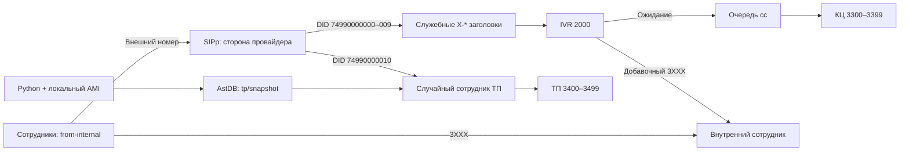

# Asterisk / PJSIP: тестовый стенд VOIP

Конфигурация АТС для внутренних звонков, IVR, очереди КЦ, выбора зарегистрированного сотрудника ТП и SIP-транка. Провайдерскую сторону в лаборатории имитирует SIPp на том же VPS. Документация описывает архитектуру, настройку и проверку стенда.

## Версия и схема

Проверенная среда: Ubuntu 26.04 LTS x86_64, Asterisk 22.11.0, Python 3, systemd, SIPp 3.7.7. Для функции наследования SIP-заголовков в ветке Asterisk 22 требуется версия не ниже 22.9.0.

## Маршруты и правила

- Внутренний диапазон 3000–3999 обрабатывается шаблоном _3XXX. В конфигурации подготовлены 3000/3001, все 3300–3399 и 3400–3499; остальные номера диапазона не выделены конкретным аккаунтам.
- 2000 — внутренний вход в IVR; 2001 — лабораторный вход в маршрут ТП.
- DID 74990000000–74990000009 — IVR: добавочный либо ожидание и очередь cc. Выбор для специального DID 74990000010 идёт напрямую в ТП. Это принятая трактовка специального требования относительно общего правила IVR.
- Очередь cc: rrmemory, 100 статических участников PJSIP/3300–3399, ringinuse=no, ограниченное ожидание и обработка отсутствия операторов.
- Скрипт через AMI выбирает действующие динамические регистрации ТП и одним DBPut сохраняет время и список. Таймер повторяет запуск через 10 секунд после завершения; снимок старше 60 секунд не используется. RAND выбирает позицию из актуального снимка.
- Внешние вызовы сотрудников идут в lab-provider: только цифры длиной 2–15, ведущий + удаляется. Входящий контекст провайдера не включает исходящие маршруты сотрудников.
- Служебные X-* заголовки первого входящего INVITE подготовлены к наследованию исходящим каналом КЦ. Копируется первое значение каждого имени; ограничения описаны в [docs/headers.md](docs/headers.md).

## Файлы

| Каталог | Назначение |
| --- | --- |
| config/ | Конфигурации Asterisk без паролей |
| scripts/ | Генераторы аккаунтов/аудио, синхронизация ТП и команды SIPp |
| systemd/ | Служба Asterisk и таймер синхронизации ТП |
| sipp/ | Сценарий входящего провайдерского вызова |
| docs/ | Развёртывание, работа компонентов, принятые решения и диагностика |
| tests/ | Матрица приёмки и локальные проверки Python |
| evidence/ | Отобранные подтверждения без секретов и сырых SIP-трасс |

Реальные пароли создаются на VPS в /etc/asterisk/local и исключены из Git. В проект не включаются AstDB, конфигурации программных телефонов, исходные журналы и личная переписка.

## Проверки и инструкции

Основной статус — [tests/acceptance.md](tests/acceptance.md). Проверены внутренние звонки и границы маршрутов, IVR, все11DID, очередь с двумя операторами, внешний скрипт и AstDB, выбор между двумя ТП, внешний лабораторный транк и эхо. Передача и изоляция X-* подтверждены по четырём INVITE двух одновременных Queue-вызовов. Автозапуск АТС/таймера включён; после restart службы подтверждены телефоны, обновления AstDB, звонки КЦ и ТП. Перезагрузка VPS и дополнительные отрицательные случаи отдельно не проверялись.

- [Развёртывание](docs/setup.md) и [диагностика](docs/operation.md).
- [Назначение и запуск скриптов](docs/scripts.md).
- [Синхронизация ТП](docs/tp-sync.md) и [случайный вызов](docs/tp-routing.md).
- [Лабораторный провайдер](docs/provider-lab.md) и [телефоны для тестов](docs/test-phones.md).
- [SIP-заголовки](docs/headers.md) и [принятые решения](docs/decisions.md).

Для воспроизведения необходим установленный Asterisk с указанными модулями, подготовленные локальные секреты и аудиофайлы. SIPp имитирует SIP-узел провайдера; действующего транка в городскую сеть у стенда нет.

- [Аудио и музыка ожидания](docs/audio.md).
